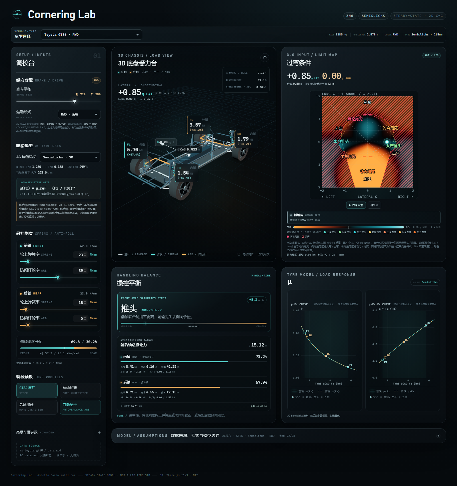

# Cornering Lab

一个面向数据说明与调校直觉的 **Assetto Corsa 多车型 3D 底盘 · 二维 G-G 抓地平衡实验台**。

打开 [`index.html`](./index.html) 即可运行。页面无网络请求、无 CDN，Three.js 已本地化到 `vendor/`。



在线版本：[hanlin-yu.github.io/cornering-lab](https://hanlin-yu.github.io/cornering-lab/)

当前可切换车型：

| 车型 | 驱动 | 数据目录 |
| --- | --- | --- |
| Toyota GT86 / ZN6 | RWD | `ks_toyota_gt86` |
| Mazda MX-5 ND | RWD | `ks_mazda_mx5_nd` |
| Mazda MX-5 Cup | RWD | `ks_mazda_mx5_cup` |
| Subaru Impreza 22B STi | AWD | `ddm_subaru_22b` |
| Honda S2000 AP1 | RWD | `ddm_honda_s2000_ap1` |
| Porsche 911 GT3 Cup 2017 | RWD | `ks_porsche_911_gt3_cup_2017` |
| Porsche Cayman GT4 Clubsport | RWD | `ks_porsche_cayman_gt4_clubsport` |
| BMW M3 E92 | RWD | `bmw_m3_e92` |
| BMW M4 | RWD | `ks_bmw_m4` |
| BMW Z4 | RWD | `bmw_z4` |
| BMW Z4 GT3 | RWD | `bmw_z4_gt3` |
| Ferrari F2004 | RWD | `ks_ferrari_f2004` |
| Mercedes-AMG GT3 | RWD | `ks_mercedes_amg_gt3` |
| Lotus Exige V6 Cup | RWD | `lotus_exige_v6_cup` |
| Lotus Exige 240R | RWD | `lotus_exige_240` |
| Chevrolet Corvette C6 Z06 | RWD | `corvette_c6_z06` |
| Mazda RX-7 Spirit R | RWD | `ks_mazda_rx7_spirit_r` |
| Honda Civic Type R 2008 | FWD | `ddm_honda_civic_type_r_2008` |
| Toyota MR-S Haru-Spec | RWD | `ddm_toyota_mrs_haru` |

## 功能

- **仪表盘布局**：左侧是独立的调校台（纵向分配、轮胎参数、悬挂刚度、预设和高级参数）；右侧是以 2 × 2 排列的 **3D 底盘 / 过弯条件 G-G / 操控平衡 / 轮胎 μ** 四个面板。μ 面板内的两张曲线图并排显示；窄屏下自动折叠为单列，移动端两张图改为纵排。
- **车型选择栏**：切换车辆时，质量、轴距、前轴荷、轮距、质心高度、轮上弹簧率 / 防倾杆轮率、制动分配、驱动形式、默认轮胎和可选胶料全部按该车 `data.acd` 更新。
- **二维 G-G 输入**：横轴为侧向 G（左 / 右），纵轴为纵向 G，**向上为制动（负纵向 G），向下为加速（正纵向 G）**，显示范围 **±2 g**；支持鼠标、触摸、方向键，轨迹保留最近 220 个点。
- **相位辅助线**：绘制 `y=0`、`y=x`、`y=-x` 三条虚线，并标注刹车、入弯、出弯、加速区域；入弯与出弯各标一侧。
- **连续推头 / 甩尾底色**：按当前底盘设置以 **0.05 g 网格**（81 × 81 节点）预计算前后轴利用率差 ΔU，再双线性插值到整个 G-G 面板；采用 ICE–黑色–FIRE 发散色图，黑色 = 中性，±25 pp 饱和。底色最多每 **1 秒**在后台刷新一次（仅在调校参数变化时重算），不随光标或回放每帧重算。
- **轴超限车辆状态**：当某轴联合利用率达到 100% 时，按 **|lat G| / |long G| 主导方向**与纵向 G 的方向分类：前轴超限且侧向主导 → 加速出弯推头 / 减速入弯推头；后轴超限且侧向主导 → 加速出弯甩尾 / 减速入弯甩尾；后轴超限且纵向主导 → 加速动力甩尾 / 减速后轮抱死；前轴超限且纵向主导 → 加速动力推头 / 减速前轮抱死；前后轴同时超限 → **失控 / LOSS OF CONTROL**。纵向 G 为 0 或 |lat G| = |long G| 时没有方向状态。非失控区域全部保留与抓地内相同的 ΔU 连续色图来表示推头 / 甩尾，方向状态只用彩色边界和文字标签标出；失控区域使用 70% 不透明度的红黑交错斜纹填充，压低其下不可能区域的 ΔU 热度，不绘制区域文字标签。这些是**轴抓地饱和分类标签**，不是滑移动力学中的真实抱死 / 甩尾仿真。
- **入弯 → 弯心 → 出弯回放**：6.2 秒自动扫过从制动入弯、trail braking 到加速出弯的连续 G 组合；状态、载荷、轴抓地力、3D 底盘、弹簧、ARB 与 μ 曲线同步刷新。
- 可旋转 / 缩放的 3D 底盘：悬挂按车种重建——AC 原始 `TYPE=DWB` 显示上下叉臂，`TYPE=STRUT` 显示支柱；MX-5 ND / Cup 前后双叉臂，GT86 / 22B 前麦弗逊，GT86 后悬按多连杆视觉重建；22B 后悬原始数据为 STRUT。其余新增车型按各自 `suspensions.ini` 的 DWB / STRUT 类型和硬点重建。摆臂、转向拉杆和 STRUT 轴线使用解包硬点，轴距 / 轮距 / 轴荷变化会实时反映到杆长和弹簧位置；空间架车身外形仍是简化示意。
- 3D **CoG 质心标签 + 垂线 / 地面投影**；G 力箭头长度由合成 G 决定，方向表示惯性力（指向弯外侧，加速指向后方）。
- 每个车轮的 3D 标签显示当前轮荷与相对静态轮荷的变化百分比；外轮为正、内轮为负。纵向 G 会同时改变前后轴的两个轮荷。
- 前后轮上弹簧率可在 **8–200 N/mm** 范围内调节；防倾杆轮率保持 0–80 / 0–60 N/mm；轮胎弹簧率在自定义轮胎中可在 **100–400 N/mm** 范围内分别调节。预设和自动配平会基于当前车型的原始轮上弹簧率与防倾杆轮率生成。
- **刹车平衡与驱动形式**：默认取所选车型 `brakes.ini` 的前轴占比和 `drivetrain.ini` 的驱动形式；页内可调刹车平衡（前轴制动占比 30–90%），并可切换 RWD / FWD / AWD（AWD 采用 50/50 近似）。
- **AC 轮胎选择**：每款车只列出该车 `tyres.ini` 中真正存在的胶料，默认胶料按 `[COMPOUND_DEFAULT] INDEX` 选择；另有自定义模式可编辑 **μ_ref / k**（前后共用，FZ0 继承上一次 AC 胶料），并可分别设置前后轮胎弹簧率。
- **逐轴轮胎模型**：新增车系常使用不同的前 / 后轮胎宽度、半径、轮胎弹簧率 RATE、FZ0 和 LS_EXPY；计算与 μ–Fz 面板分别读取 FRONT / REAR 参数。前后轴参数不同时，两条曲线会分开显示；WIDTH 本身不进入载荷敏感幂律。
- **轮胎弹簧率串联**：AC `tyres.ini` 的 `RATE` 作为每轮轮胎弹簧率；侧倾刚度使用 `k_ground = 1 / (1/(k_spring + k_ARB) + 1/k_tyre)`。轮胎模型中显示前后轮胎弹簧率，选择自定义轮胎时可分别设置前后值。轮胎弹簧率也参与车轮压缩视觉。
- **操控平衡面板整合轴抓地信息**：状态结论、ΔU 横向指示条、前后轴总抓地力 / 合成需求 / 联合利用率 / 余量，以及 ΔFz 和 Fx/Fy 分解放在同一面板；不再额外重复一组轴卡。
- **μ 面板并排双图**：左图是前后轴的 μ–Fz 曲线，右图是前后轴轮胎的 **μ × Fz–Fz 抓地力曲线**；两图采用相同的尺寸、坐标轴结构与轮荷标记格式，四个标记点对应当前 FL / FR / RL / RR 的实际轮荷。图表下方不再重复显示四轮 μ 数值芯片。
- 内侧轮离地、轴荷卸载、总抓地力不足、轴饱和、低载荷敏感度等警告。
- **模型范围说明**：仅模拟底盘重心 / 载荷转移与载荷敏感 μ(Fz)；忽略轮胎滑移角、滑移率对 μ 的影响。

## 数据来源

从 Assetto Corsa 安装目录只读解包各车的 `data.acd`：

```text
<AC install>/content/cars/<car folder>/data.acd
```

原始游戏文件没有被修改。各车关键数据：

| 项目 | GT86 | MX-5 ND | MX-5 Cup | 22B STi |
| --- | --- | --- | --- | --- |
| 质量（含车手，无燃油） | 1285 kg | 1133 kg | 983 kg | 1297 kg |
| 轴距 | 2.570 m | 2.310 m | 2.310 m | 2.520 m |
| 前轴荷 | 57.5% | 53.0% | 54.0% | 63.0% |
| 前 / 后轮距 | 1.520 / 1.540 m | 1.496 / 1.503 m | 1.525 / 1.510 m | 1.480 / 1.500 m |
| 质心高度（估算） | 0.423 m | 0.458 m | 0.455 m | 0.496 m |
| 轮上弹簧率 F / R | 23.0 / 18.0 N/mm | 11.7 / 13.4 N/mm | 51.0 / 77.0 N/mm | 35.6 / 32.8 N/mm |
| 防倾杆轮率 F / R | 39.0 / 5.0 N/mm | 19.0 / 4.8 N/mm | 39.0 / 4.8 N/mm | 18.0 / 16.2 N/mm |
| 制动前 / 后分配 | 72 / 28% | 72 / 28% | 75 / 25% | 78 / 22% |
| 驱动形式 | RWD | RWD | RWD | AWD |
| 悬挂（AC 原始）F / R | STRUT / DWB | DWB / DWB | DWB / DWB | STRUT / STRUT |
| 3D 悬挂视觉 F / R | 麦弗逊 / 多连杆 | 双叉臂 / 双叉臂 | 双叉臂 / 双叉臂 | 麦弗逊 / 多连杆 |
| 默认轮胎 | Semislicks | Semislicks | Slicks | Semislicks |

新增 15 款车的关键数据（悬挂类型为 AC 原始值）：

| 车型 | 质量 | 轴距 | 前轴荷 | 轮上弹簧率 F/R | 防倾杆轮率 F/R | 制动 F/R | 驱动 | 悬挂 F/R | 默认轮胎 |
| --- | --- | --- | --- | --- | --- | --- | --- | --- | --- |
| S2000 AP1 | 1315 kg | 2.400 m | 50.0% | 23.1 / 30.4 N/mm | 16.7 / 8.8 N/mm | 62 / 38% | RWD | DWB / DWB | OEM |
| 911 GT3 Cup 2017 | 1300 kg | 2.458 m | 38.0% | 61.8 / 56.6 N/mm | 33.5 / 15.7 N/mm | 62 / 38% | RWD | STRUT / DWB | Slick Cup |
| Cayman GT4 CS | 1375 kg | 2.484 m | 46.0% | 165.0 / 170.0 N/mm | 32.0 / 20.0 N/mm | 68 / 32% | RWD | STRUT / STRUT | Slick Hard |
| M3 E92 | 1680 kg | 2.761 m | 51.6% | 28.0 / 37.0 N/mm | 20.0 / 6.8 N/mm | 66.5 / 33.5% | RWD | STRUT / DWB | Semislicks |
| M4 | 1647 kg | 2.812 m | 52.0% | 32.8 / 34.5 N/mm | 36.0 / 8.0 N/mm | 71 / 29% | RWD | STRUT / DWB | Semislick |
| Z4 | 1680 kg | 2.495 m | 51.5% | 26.8 / 37.0 N/mm | 17.0 / 8.0 N/mm | 70 / 30% | RWD | STRUT / DWB | Semislicks |
| Z4 GT3 | 1305 kg | 2.510 m | 53.0% | 170.0 / 75.0 N/mm | 55.0 / 22.0 N/mm | 72 / 28% | RWD | STRUT / DWB | Slick Medium |
| F2004 | 605 kg | 3.050 m | 44.8% | 40.0 / 60.0 N/mm | 40.0 / 15.0 N/mm | 55 / 45% | RWD | DWB / DWB | Slick Medium |
| AMG GT3 | 1360 kg | 2.650 m | 48.0% | 80.0 / 120.0 N/mm | 50.0 / 18.7 N/mm | 71 / 29% | RWD | DWB / DWB | Slick Medium |
| Exige V6 Cup | 1155 kg | 2.370 m | 41.0% | 42.7 / 72.6 N/mm | 31.0 / 4.5 N/mm | 63.5 / 36.5% | RWD | DWB / DWB | Semislicks |
| Exige 240R | 1005 kg | 2.300 m | 41.0% | 33.4 / 57.8 N/mm | 28.0 / 0 N/mm | 72 / 28% | RWD | DWB / DWB | Semislicks |
| Corvette C6 Z06 | 1495 kg | 2.685 m | 51.2% | 55.8 / 61.6 N/mm | 20.0 / 7.8 N/mm | 64.5 / 35.5% | RWD | DWB / DWB | Michelin PS2 |
| RX-7 Spirit R | 1345 kg | 2.425 m | 50.0% | 40.0 / 40.0 N/mm | 21.5 / 9.0 N/mm | 67.5 / 32.5% | RWD | DWB / DWB | Semislicks |
| Civic Type R 2008 | 1345 kg | 2.700 m | 60.4% | 47.0 / 40.0 N/mm | 17.5 / 17.0 N/mm | 70 / 30% | FWD | STRUT / DWB | Street |
| MR-S Haru-Spec | 955 kg | 2.450 m | 42.5% | 45.6 / 64.5 N/mm | 14.8 / 10.4 N/mm | 50 / 50% | RWD | STRUT / STRUT | Advan A052 |

数据来源：

- 质量、轴距、前轴荷、轮距、轮上弹簧率、防倾杆轮率、`BASEY`：`car.ini` / `suspensions.ini`。
- 摆臂 / 转向 / STRUT 硬点：`suspensions.ini` 的 `STRUT_CAR / STRUT_TYRE`、`WBCAR_* / WBTYRE_*`。
- 制动分配、驾驶舱可调性：`brakes.ini [DATA] FRONT_SHARE / COCKPIT_ADJUSTABLE`。
- 驱动形式：`drivetrain.ini [TRACTION] TYPE`。
- 轮胎参数：`tyres.ini` 各 `[FRONT*] / [REAR*]` 段。

质心高度按默认胶料的 `RADIUS − BASEY（前后按轴荷加权）` 估算；初始四车前后轮胎同宽同参数，新增车按各自 FRONT / REAR 参数读取。防倾杆轮率的 AC 原文件注释与 CSP 文档在单位表述上存在差异；本项目把 `[ARB]` 值当作轮端等效轮率处理。`PROGRESSIVE_SPRING_RATE` 仅记录在数据中，本稳态模型使用基础 `SPRING_RATE`。

### 3D 悬挂几何与来源边界

| 车型 | 前悬 | 后悬 | 3D 弹簧 / 减振器位置 |
| --- | --- | --- | --- |
| GT86 | STRUT（AC） | DWB（AC）→ 多连杆视觉 | 前：精确沿 `STRUT_CAR–STRUT_TYRE`；后：按上摆臂推导 |
| MX-5 ND | DWB（AC） | DWB（AC） | 前后均按上摆臂推导 |
| MX-5 Cup | DWB（AC） | DWB（AC） | 前后均按上摆臂推导 |
| 22B STi | STRUT（AC） | STRUT（AC）→ 多连杆视觉 | 前后：精确沿 `STRUT_CAR–STRUT_TYRE` |

- AC 悬挂硬点坐标以**轮心**为局部基准：`x` 为轮心向内的横向偏移，`y` 相对轮心，`z` 相对该轴轴线。3D 重建时按所选车轴距 / 轮距换到世界坐标，再根据车身缩放换算到车架局部坐标。
- 下摆臂、上摆臂、转向拉杆和 STRUT 轴线的两端都直接使用 AC 硬点，因此杆长和安装位置随车型真实变化；双叉臂的上下摆臂以两条连杆表示。
- **DWB / 多连杆的弹簧上安装点不在 AC 数据中**：`suspension_graphics.ini` 为空，AC 只给出 STRUT 车的减振器轴线。为了让 DWB 车也能显示弹簧，3D 采用显式推导轴：下端在下摆臂靠近轮端、轮胎内侧面内侧的推导点；上端的横向位置在“上摆臂内铰点—上球头”之间取 55 / 45，纵向取上摆臂前后铰点中点，高度取轮心以上 0.52 m。页面和本 README 都标注了这一点，不能把这一轴当作 AC 原始硬点。
- **22B 后悬**：AC `suspensions.ini` 的后悬 `TYPE=STRUT`，没有多连杆上摆臂硬点。3D 不会凭空生成上摆臂；它显示真实的下摆臂、转向拉杆和支柱，UI 按请求标注为“多连杆”并在来源行括注 `TYPE=STRUT`。
- 新增车型按各自的 AC `TYPE` 重建：`DWB` 使用上下叉臂硬点，弹簧轴按上述规则推导；`STRUT` 使用下摆臂、转向拉杆和 `STRUT_CAR–STRUT_TYRE` 精确轴线。上表列出的四车规则同样适用于新增车系。
- 空间架车身、防倾杆杆身和减振器外观是简化视觉件；只有悬挂硬点、摆臂长度、STRUT 轴和弹簧的推导位置与所选车型数据相关。

### 轮胎胶料

19 款车的 `tyres.ini` 均未提供 `DY_CURVE`，因此统一使用 AC 的载荷敏感幂律。初始四车的胶料数据如下（前后相同）；新增车按 `[FRONT*] / [REAR*]` 分别读取 FZ0、DY_REF、LS_EXPY、宽度、半径和轮胎弹簧率 RATE。例如 911 GT3 Cup 为前 270 / 后 310 mm、FZ0 3447 / 3881 N，F2004 为前 245 / 后 325 mm、FZ0 3451 / 3995 N。个别带分号的双值参数取第一个值（如 MR-S 前胎 OEM `LS_EXPY=0.793;0.803`）。

| 车型 | 胶料 | 宽度 | 半径 | 轮胎弹簧率 RATE | FZ0 | DY_REF | LS_EXPY | k = 1 − LS_EXPY |
| --- | --- | --- | --- | --- | --- | --- | --- | --- |
| GT86 | ECO | 215 mm | 0.3126 m | 263372 N/m | 2274 N | 1.215 | 0.7227 | 0.2773 |
| GT86 | Street | 215 mm | 0.3126 m | 263372 N/m | 2274 N | 1.23 | 0.8227 | 0.1773 |
| GT86 | Semislicks（默认） | 215 mm | 0.3126 m | 262593 N/m | 2494 N | 1.28 | 0.8119 | 0.1881 |
| MX-5 ND | Street | 205 mm | 0.30815 m | 233568 N/m | 2517 N | 1.23 | 0.8243 | 0.1757 |
| MX-5 ND | Semislicks（默认） | 205 mm | 0.30815 m | 228695 N/m | 2737 N | 1.28 | 0.8135 | 0.1865 |
| MX-5 Cup | Slicks（默认） | 215 mm | 0.305 m | 202410 N/m | 3045 N | 1.46 | 0.7094 | 0.2906 |
| 22B | Street | 235 mm | 0.310 m | 263038 N/m | 2590 N | 1.23 | 0.8341 | 0.1659 |
| 22B | Semislicks（默认） | 235 mm | 0.310 m | 277119 N/m | 2860 N | 1.28 | 0.84 | 0.16 |

轮胎弹簧率 RATE 同时用于 3D 轮胎压缩视觉与接地轮率串联；WIDTH 不进入 μ(Fz) 载荷敏感幂律。

## 模型

```text
正 lateralG = 右转；负 lateralG = 左转；载荷转移取 |a_y|
k_susp,axle = k_spring + k_ARB
k_ground,axle = 1 / (1 / k_susp,axle + 1 / k_tyre,axle)
Kφ,axle    = k_ground,axle · t² / 2
share_F    = Kφ,F / (Kφ,F + Kφ,R)
ΔFz_lat,F  = share_F · m · |a_y| · h / t_F   (每只外侧轮 +，内侧轮 −)
ΔFz_long   = m · a_x · h / L
Fz_F       = Fz_F,static − ΔFz_long
Fz_R       = Fz_R,static + ΔFz_long

k_F, k_R   = 1 − LS_EXPY,F / 1 − LS_EXPY,R
μ_F(Fz)    = μ_ref,F · (Fz / FZ0,F)^(−k_F)
μ_R(Fz)    = μ_ref,R · (Fz / FZ0,R)^(−k_R)
Fy,max     = μ_axle(Fz) · Fz
Fgrip,axle = Σ Fy,max

brake_F    = 当前车型 brakes.ini FRONT_SHARE（页内可调）
drive_F / drive_R = RWD 0 / 100 · FWD 100 / 0 · AWD 50 / 50
Fx,front / Fx,rear = 制动 m·a_x · brakeF / (1−brakeF)；
                     加速 m·a_x · drive_F / drive_R
F_res,axle = √(Fy,demand² + Fx,demand²)
U          = F_res,axle / Fgrip,axle
ΔFz%       = ΔFz_lat / Fz_axle
```

- 轮上弹簧率与防倾杆轮率首先合并成每侧悬挂轮率，再与轮胎弹簧率串联成接地轮率，由它给出前后侧倾刚度分配。侧向载荷转移只由侧倾刚度分配决定；每轮变化量是 `share·M/t`，内外轮等量反向。
- 内侧轮离地时按轴荷守恒截断内外轮载荷；超过线性范围后不会把剩余侧倾力矩重新分给另一轴。纵向载荷转移也按总法向载荷守恒截断。
- 纵向 G 通过质心高度与轴距在前后轴间转移垂直载荷；每个车轮的 μ 按其实际 Fz 查曲线。
- 前 / 后轴总抓地力是该轴两只轮胎的 `Fy,max` 之和。
- 合成需求包含侧向需求和纵向需求；利用率高的一轴先达到联合极限：前轴高 → understeer；后轴高 → oversteer。
- G-G 底色对 0.05 g 网格逐节点计算同样的模型：用前后轴联合利用率差 ΔU 着色，双线性插值到面板。抓地内和轴超限的非失控区域都使用同一套 ΔU 色图；八种方向状态只绘制彩色边界和标签，失控区域使用 70% 不透明度的红黑交错斜纹填充且不绘制区域文字标签。每隔 1 秒仅在参数变化时重算一次。
- 车辆状态判定（U ≥ 100% 表示该轴达到联合抓地圆极限）：
  ```text
  U_F ≥ 1 且 U_R ≥ 1                       → 失控 / LOSS OF CONTROL
  前轴 U_F ≥ 1，|lat| > |long|，a_x > 0     → 出弯推头 / CORNER-EXIT UNDERSTEER
  前轴 U_F ≥ 1，|lat| > |long|，a_x < 0     → 入弯推头 / CORNER-ENTRY UNDERSTEER
  后轴 U_R ≥ 1，|lat| > |long|，a_x > 0     → 出弯甩尾 / CORNER-EXIT OVERSTEER
  后轴 U_R ≥ 1，|lat| > |long|，a_x < 0     → 入弯甩尾 / CORNER-ENTRY OVERSTEER
  后轴 U_R ≥ 1，|lat| < |long|，a_x > 0     → 动力甩尾 / POWER OVERSTEER
  后轴 U_R ≥ 1，|lat| < |long|，a_x < 0     → 后轮抱死 / REAR LOCK
  前轴 U_F ≥ 1，|lat| < |long|，a_x > 0     → 动力推头 / POWER UNDER
  前轴 U_F ≥ 1，|lat| < |long|，a_x < 0     → 前轮抱死 / FRONT LOCK
  a_x = 0 或 |lat| = |long|                 → 无方向状态；用 ΔU 色图判断推头 / 甩尾
  ```
- **轮胎宽度 WIDTH 没有进入这条 AC 载荷敏感幂律**，因此页面不做宽度输入；它显示所选胶料前 / 后的实际宽度。前后轴会分别使用各自的 FZ0 / LS_EXPY，参数不同时两条 μ–Fz 曲线会分开。
- **本模型只模拟底盘重心 / 载荷转移和载荷敏感 μ(Fz)**；轮胎滑移角、滑移率、侧偏刚度与轮胎松弛对 μ 的影响全部忽略。μ 曲线仅随垂向载荷变化。
- AC 前后轴制动分配不是滑移模型的一部分：即使忽略滑移对 μ 的影响，纵向力如何分到前后轴仍会决定每轴合成需求与联合利用率，因此作为显式假设。

## 运行与测试

直接双击 `index.html`，或在本目录运行：

```powershell
Start-Process ".\index.html"
```

物理模型断言：

```powershell
node tests/model.test.js
```

当前 25 项测试覆盖：默认 GT86 载荷与平衡、左右轮载荷守恒、**轮对力矩平衡**（而非仅载荷总和）、每只轮胎的 AC 幂律、三种胶料参数、19 车 41 种胶料的前后轮胎弹簧率、19 车几何 / 驱动 / 制动 / 轮胎默认值、19 车悬挂硬点与原始 / 视觉悬挂类型、前后轴独立轮胎表、九种轴超限状态（含八种方向状态与失控）、自定义制动占比、RWD / FWD / AWD 驱动分配、正负侧向 G 的转向 / 载荷侧对称性、前后刚度对抓地力的方向性、零载荷敏感度下刚度不改变平衡、自动配平的成功与不可达边界、轮荷截断 / 离地 / 轴荷守恒、轮胎弹簧率串联、总抓地力超限、纵向载荷转移与总载荷守恒、二维 G 对平衡的影响、轮距对侧倾刚度的影响、参考转弯半径、轮上弹簧率 200 N/mm 上限。

## 文件

```text
index.html            页面结构
styles.css            仪表台与响应式样式
model.js              纯函数稳态模型 + 19 车数据（UMD，可在 Node 测试）
app.js                UI、车型 / 轮胎选择、二维 G-G 面板、超限状态标记、回放、图表
scene3d.js            Three.js 3D 底盘、逐车悬挂硬点、弹簧、ARB、相机控制
tests/model.test.js   模型测试
vendor/three.min.js   Three.js r149（MIT）
vendor/THREE-LICENSE.txt
docs/                 验收截图
```

## 边界

这是用于解释和参数探索的**稳态机构 / 轮胎合力模型**，不是 AC 物理引擎复刻或圈速模拟器。

- **仅模拟载荷转移 + 荷重 μ**；不含轮胎滑移角 / 滑移率对 μ 的建模。动力甩尾 / 动力推头 / 前轮抱死 / 后轮抱死是“轴联合需求达到抓地圆极限”的分类标签，不是对真实滑移或抱死瞬态的仿真。
- 3D 的空间架车身与防倾杆杆身是简化视觉件；摆臂、转向拉杆和 STRUT 轴线使用所选车型的 AC 硬点。DWB / 多连杆的弹簧上支点、22B 后悬的多连杆标签与实际 STRUT 数据之间的差异，见上文“3D 悬挂几何与来源边界”。正侧向 G 按右转、负侧向 G 按左转处理。
- 驱动形式默认来自 `drivetrain.ini`；AWD 统一按 50/50 近似，未建模中央差速器 / DCCD 分配。制动占比可在页面调整；部分新增赛车（如 911 Cup、Z4 GT3、AMG GT3、F2004）在 AC 中允许驾驶舱调制动，本页滑块仍是统一的分析用输入。
- 空气动力学 / 下压力、渐进弹簧曲线、轮胎滑移动力学均未建模；F2004、GT3 等车的结果主要反映机械抓地趋势。3D 轮胎使用统一的视觉半径与宽度，物理和曲线面板使用 AC 数据中的逐轴半径 / 宽度。
- 不含：空气动力学、差速器锁止、动态 EBD、轮胎纵向松弛、侧倾中心 / 几何载荷转移、轮胎温度 / 压力、Camber / Toe、瞬态响应。
- 联合抓地力按摩擦圆处理（各方向 μ 相同），不区分轮胎纵向 / 侧向各向异性。
- 所有结果用于比较趋势，不作绝对圈速或极限驾驶预测。

外部参考：[CSP suspension docs](https://github.com/ac-custom-shaders-patch/acc-extension-config/wiki/Cars-%E2%80%93-Suspension)、[OptimumG springs & dampers](https://optimumg.com/wp-content/uploads/2020/01/SpringsDampers_Tech_Tip_2.pdf)、[Three.js](https://threejs.org/)。
